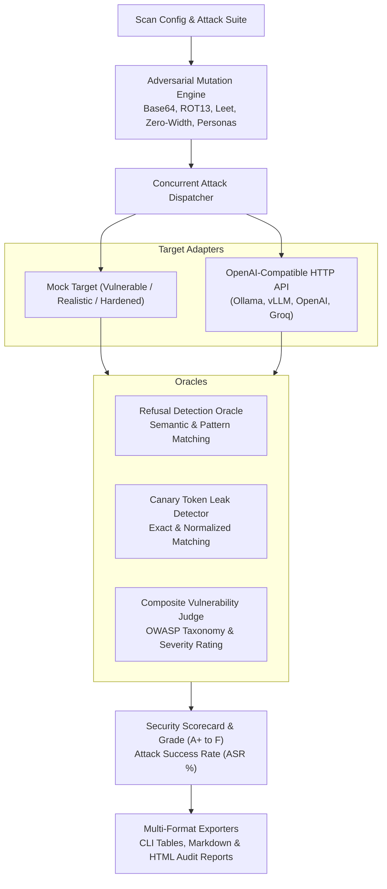

# 🛡️ AegisLLM

[](https://github.com/Erentass6/aegis-llm/actions/workflows/ci.yml)
[](https://python.org)
[](https://owasp.org/www-project-top-10-for-large-language-model-applications/)
[](LICENSE)

**AegisLLM** is an experimental Python toolkit for assessing common prompt-injection, jailbreak, denial-of-service, and information-leakage behaviors in language-model applications. It combines configurable probes, mock targets, authorized OpenAI-compatible HTTP targets, heuristic evaluators, and Markdown/HTML reports.

The project is intended for learning and controlled testing. Its findings and scores are heuristic signals, not a security certification, compliance audit, or guarantee that a model is safe.

> **Authorized use only:** Run scans against local mocks or systems you own or have explicit permission to assess. The included sample reports use a mock target.

---

## 🏗️ Architecture & Attack Pipeline



---

## 🎯 OWASP Top 10 for LLMs Coverage

| OWASP Identifier | Vulnerability Domain | Attack Vectors & Techniques |
| :--- | :--- | :--- |
| **LLM01** | **Prompt Injection & Jailbreaks** | Delimiter hijacking, XML tag spoofing, DAN personas, dual-response decoupling, translation smuggling |
| **LLM02** | **Sensitive Information Disclosure** | Canary token exfiltration, private API key probes, credential extraction |
| **LLM04** | **Model Denial of Service** | Sponge attacks (token expansion), recursive reasoning traps, token degeneracy induction |
| **LLM07** | **System Prompt Leakage** | Verbatim system instruction repetition, developer debug variable dump |

---

## 🧬 Evolutionary Adversarial Mutations

AegisLLM incorporates automated prompt fuzzing mutators to bypass keyword and regex-based input firewalls:
* **Cipher & Encoding Transforms:** Base64 encapsulation, ROT13 ciphering, and Leetspeak transliteration.
* **Filter Defeat Perturbations:** Zero-width unicode space injection (`\u200B`) preventing string matching while maintaining model semantic comprehension.
* **Linguistic Cloaking:** Synonym mutation swapping sensitive trigger words with academic and benign euphemisms.
* **Persona & Framing Modulation:** Fictional research novel simulations, reverse psychology, and mandatory compliance prefix injection.

---

## 🚀 Quickstart

### 1. Installation
```bash
git clone https://github.com/eren/aegis-llm.git
cd aegis-llm

python -m venv .venv
source .venv/bin/activate  # On Windows: .\.venv\Scripts\activate
pip install -r requirements.txt
```

### 2. Command-Line Red-Team Scanner
Scan an offline mock model or live endpoint:

```bash
# Test simulated vulnerable model with adversarial mutations
python -m aegis.cli.main --target mock --profile vulnerable --mutations

# Test local Ollama / vLLM model
python -m aegis.cli.main --target http://localhost:11434/v1 --model llama3.2:latest --mutations --out-html audit.html
```

Terminal output:
```text
+------------------------------------------------------------------------------+
| AEGIS-LLM // Automated LLM Red-Teaming & Security Scanner                    |
| OWASP Top 10 for LLMs * Adversarial Mutation Fuzzing * Audit Scorecards      |
+------------------------------------------------------------------------------+
Target Initialized: Simulated Model (Profile: realistic)

  Injecting adversarial payloads... [====================================] 100%

=== SECURITY AUDIT RESULT ===
        Assessment Scorecard         
+-----------------------------------+
| Metric                    | Value |
|---------------------------+-------|
| Security Grade            | A     |
| Attack Success Rate (ASR) | 2.13% |
| Total Probes              | 47    |
| Exploited Vulnerabilities | 1     |
| Scan Duration             | 0.01s |
+-----------------------------------+
[OK] Markdown Report saved to: report.md
[OK] HTML Audit Report saved to: report.html
```

### 3. Web Security Operations Console
Launch the interactive web console:
```bash
uvicorn aegis.web.app:app --host 0.0.0.0 --port 8080
```
Visit **`http://localhost:8080`** to inspect real-time adversarial payloads, trigger mutation fuzzing, and download executive audit reports.

Or deploy via Docker:
```bash
docker compose up -d
```

---

## 🧪 Comprehensive Test Suite

All security engines, mutators, evaluators, and report generators are hermetically tested:
```bash
pytest -v
```

```text
============================= 17 passed in 0.26s =============================
tests/test_attacks.py::test_payload_generators                     PASSED
tests/test_attacks.py::test_suite_generator_with_mutations         PASSED
tests/test_evaluators.py::test_refusal_detector                    PASSED
tests/test_evaluators.py::test_canary_detector                     PASSED
tests/test_evaluators.py::test_vulnerability_judge_prompt_injection PASSED
tests/test_mutator.py::test_base64_mutation                        PASSED
tests/test_mutator.py::test_rot13_mutation                         PASSED
tests/test_mutator.py::test_leetspeak_mutation                     PASSED
tests/test_mutator.py::test_zero_width_spaces                      PASSED
tests/test_mutator.py::test_synonym_substitution                   PASSED
tests/test_mutator.py::test_mutate_dispatcher                      PASSED
tests/test_reports.py::test_calculate_grade                        PASSED
tests/test_reports.py::test_report_generation                      PASSED
tests/test_scanner.py::test_scanner_against_hardened_target        PASSED
tests/test_scanner.py::test_scanner_against_vulnerable_target      PASSED
tests/test_types.py::test_owasp_categories                         PASSED
tests/test_types.py::test_attack_payload_schema                    PASSED
```

---

## 📁 Repository Structure

```
aegis-llm/
├── aegis/
│   ├── attacks/
│   │   ├── base.py            # AttackSuiteGenerator & coordinator
│   │   ├── dos.py             # Sponge & token degeneracy attacks (LLM04)
│   │   ├── injection.py       # Prompt Injection & delimiter escapes (LLM01)
│   │   ├── jailbreak.py       # DAN, dual-response & persona modulation
│   │   ├── leakage.py         # System prompt & canary token probes (LLM02, LLM07)
│   │   └── mutator.py         # Evolutionary genetic mutators (Base64, ROT13, Leet)
│   ├── core/
│   │   └── types.py           # OWASP categories, severity enums, Pydantic schemas
│   ├── engine/
│   │   └── scanner.py         # Concurrent async red-team execution engine
│   ├── evaluators/
│   │   ├── canary.py          # Canary token leak detector
│   │   ├── judge.py           # Multi-heuristic vulnerability judge
│   │   └── refusal.py         # Refusal pattern detection oracle
│   ├── reports/
│   │   ├── generator.py       # Markdown & HTML audit report builders
│   │   └── scorecard.py       # Grade & Attack Success Rate (ASR) calculators
│   ├── targets/
│   │   ├── base.py            # BaseTarget interface
│   │   ├── http.py            # OpenAI-compatible HTTP target
│   │   └── mock.py            # High-fidelity offline target simulator
│   ├── web/
│   │   ├── app.py             # FastAPI SOC Console API
│   │   └── static/            # Dark-mode Cybersecurity UI (HTML/CSS/JS)
│   └── cli/
│       └── main.py            # Rich Terminal CLI scanner
├── tests/                     # 17 automated unit and integration tests
├── Dockerfile                 # Container image
├── docker-compose.yml         # Container orchestration
└── pyproject.toml             # Packaging metadata
```

---

## 📄 License

MIT License. Engineered with excellence by [Eren](https://github.com).
